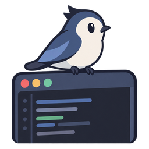

<p align="center">
  
</p>

<h1 align="center">Perch · 栖栖</h1>

<p align="center">一只住在 Windows 桌面上的小桌宠：会聊天、能读写文件，还会替你盯着 Claude Code / Codex / DeepSeek Harness 干活。</p>

Perch 平时站在任务栏和窗口的顶边上，走来走去、跳上跳下，像停在窗沿的小鸟。点一下她就能聊天；你的编程 agent 在思考、等授权、干完活的时候，她会用动画、身边的小标签和气泡告诉你。

> 目前只支持 Windows 10 / 11（x64）。

## 功能

**桌宠本体**
- 默认形象是内置的蓝白小鸟「栖栖」：在窗沿上蹦跳、扇翅膀飞上飞下，思考时歪头冒问号，等你授权时竖起头冠，工作时啄键盘，睡觉时把头埋起来。
- 也可以换成 Codex 宠物格式的精灵图皮肤（`pet.json` + 图集）。
- 在任务栏上沿走动，会自己跳上、跳下窗口顶边；站着的窗口被挪动会跟着走，被盖住会掉下来。
- 可以拖拽，松手后下落；透明区域鼠标穿透。
- 工作模式（不乱走乱跳）；全屏看视频、玩游戏时自动隐藏。
- 可选开机自启动（默认关闭，在「设置 → 常规」里打开）。

**对话**
- 接 OpenAI 兼容接口（DeepSeek、通义、OpenRouter、SiliconFlow 等），可以配多个服务商，按用途分配模型。
- 人格（参考 AstrBot）：名字、系统提示词、预设对话、各自的皮肤。
- 点桌宠弹出输入气泡，一键展开成聊天窗口；流式回复。
- 每个人格一条连续对话，自动滚动总结；长期记忆在人格之间共享，可在设置里查看和修改。
- 记忆检索（可选）：在「设置 → 模型」里配一个向量模型（OpenAI 兼容的 `/embeddings`，比如硅基流动的 `BAAI/bge-m3`），事件记忆就只挑和当前话题相关的几条放进提示词，能记得更多；不配就全部放进去。向量服务出错时自动退回全部放入。
- 可以发图片（主模型看不了图时由视觉模型转述）和文件（文本、PDF、docx）。
- 支持推理强度设置，不支持的模型自动忽略。
- **主动聊天和提醒**（可选，默认关闭，在「设置 → 陪伴」里打开）：很久没聊天时找你说两句，久坐、就寝、每日定时提醒，agent 一直等你授权时再提一次。话由模型按人格口吻写，也可以只用固定话术。全屏、对话中、录音时不打扰；工作模式和免打扰时段只说重要的提醒。

**工具与生图**
- 内置读、写、编辑文件三个工具，只能访问白名单目录；读文件不打扰，写入和编辑会在气泡里显示 diff 等你确认。没有 shell。
- 云端生图（OpenAI 兼容的 `/images/generations`）：`/draw 描述`，或者明确让她画；有每日上限。

**语音输入（可选，默认关闭）**
- 本地识别：SenseVoice + Silero VAD（sherpa-onnx），不上传录音。
- 在「设置 → 语音」里开启，一键下载语音组件：运行库约 7.5MB（来自 sherpa-onnx 官方发布），模型约 240MB（优先走 hf-mirror 镜像）；也可以指定已有的运行库和模型文件夹。
- 按住快捷键（默认 `Ctrl+Shift+Space`）或 🎤 说话，边说边在输入框里预览，松开即识别并发送。
- 不开启时不加载任何语音组件，程序本身不依赖它们。

**Agent 状态汇报**
- **Claude Code**：在 `~/.claude/settings.json` 写入 http 类型 hooks。
- **Codex**：在 `~/.codex/hooks.json` 写入命令型 hooks（一行 PowerShell，把事件转发给桌宠）。
- **DeepSeek Harness**：安装一个 DSH 组合包插件。
- 桌宠动画随状态变化，身边显示「Claude Code · 思考中」「等待授权」这样的小标签；完成、等授权、出错时弹气泡和系统通知，完成时可以用当前人格的口吻总结一两句。
- 第一次启动时检测本机装了哪些 agent，问你要不要接入；也可以随时在设置里开关。

## 从源码运行

需要：

- [Rust](https://rustup.rs/)（stable，MSVC 工具链）和 Visual Studio 的「使用 C++ 的桌面开发」组件
- [Node.js](https://nodejs.org/) 20+ 和 [pnpm](https://pnpm.io/)
- WebView2（Windows 11 自带）

```sh
pnpm install
pnpm tauri dev
```

第一次构建时，`sherpa-onnx` 会从 GitHub 下载预编译库，构建脚本会把 `sherpa-onnx-c-api.dll`、`onnxruntime.dll` 等复制到程序旁边，所以从源码运行时不用再下载语音运行库。程序对这些 DLL 是延迟加载的：只有开启语音输入后才会加载。

运行测试：

```sh
cd src-tauri
cargo test --lib
```

## 使用

1. 右键托盘图标 →「设置」，在「模型」里添加服务商（地址、模型名、API Key），在「人格」里写好她的性格。
2. 单击桌宠开始聊天。想用语音输入，到「语音」里开启并下载语音组件，之后按住 `Ctrl+Shift+Space` 说话。
3. 想让她读写文件，先在「工具与生图」里加白名单目录；生图服务也在这里配置。
4. 在「Agent 接入」里打开需要的接入：
   - Codex：开启或修复后，要在 Codex 里输入 `/hooks` 信任桌宠的 hooks。
   - DeepSeek Harness：需要先在 DSH 菜单「管理 dsh 命令…」里安装命令行；装好插件后重启 DSH。

**皮肤**：默认是内置的栖栖。想换别的，把 Codex 宠物文件夹放进 `%USERPROFILE%\.codex\pets\` 或 `%APPDATA%\Perch\skins\`，在托盘「皮肤」菜单里选择。自己做皮肤的格式见 [docs/skin-format.md](docs/skin-format.md)。

**渲染器插件**：精灵图集以外的形象（比如骨骼动画）由插件负责画，插件放在 `%APPDATA%\Perch\plugins\` 下，皮肤在 `skin.json` 里写明要用哪个渲染器，用到时才加载。插件格式见 [docs/renderer-plugin.md](docs/renderer-plugin.md)，[examples/renderer-plugin](examples/renderer-plugin) 里有一个可以直接用的示例。插件代码在桌宠窗口里运行，只安装你信任的插件。

## 数据与隐私

- 设置、聊天记录、记忆、语音模型和运行库都在 `%APPDATA%\Perch`；API Key 存在 Windows 凭据管理器，不写进配置文件。
- 聊天内容会发给你配置的模型服务商。开启「完成时用人格口吻总结」后，agent 的最后一条回复也会发给辅助模型；关掉则不转发任何内容。
- 语音识别完全在本地进行。
- Agent 接入会修改对应工具的配置文件：第一次改动前自动备份，只增删桌宠自己的条目，关闭接入即可移除。
- 接收 agent 事件的服务只监听 `127.0.0.1`，并校验随机令牌。

## 已知限制

- 安装包不附带语音运行库，开启语音输入时在设置里下载（运行库来自 GitHub，网络不好时可以手动下载 [sherpa-onnx v2.0.0 的 Windows 动态库](https://github.com/k2-fsa/sherpa-onnx/releases/download/v2.0.0/sherpa-onnx-v2.0.0-win-x64-shared-MT-Release-lib.tar.bz2)，解压后在设置里指定 `lib` 文件夹）。
- 换了运行库文件夹要重启程序才生效。
- 只支持 Windows。
- 预留了接口、尚未实现：TTS 语音输出、在桌宠里审批 agent 授权、本地生图。

## 致谢

- [Tauri](https://tauri.app/)
- [sherpa-onnx](https://github.com/k2-fsa/sherpa-onnx)（Apache-2.0）
- 语音模型 [SenseVoice](https://github.com/FunAudioLLM/SenseVoice) 和 [Silero VAD](https://github.com/snakers4/silero-vad) 在运行时下载，不随本仓库分发，使用时请遵守各自的许可证。
- 设计上参考了 BongoCat、clawd-on-desk、VPet、DyberPet 等桌宠项目（只参考设计，没有使用它们的代码）。

## 许可证

[PolyForm Noncommercial License 1.0.0](LICENSE)（SPDX：`PolyForm-Noncommercial-1.0.0`）。

- 允许非商业用途的使用和修改：个人学习、研究、娱乐和爱好项目，以及慈善机构、教育机构、公共研究机构、公共安全或卫生组织、环保组织、政府机构使用。**禁止商业用途**，需要商用授权请通过 [GitHub Issues](https://github.com/mtdxmtdx/Perch/issues) 联系作者。
- 再分发时要附上许可证全文（或链接）和 `LICENSE` 开头的 `Required Notice` 版权声明。
- 这是"源码公开、禁止商用"的许可证，不属于 OSI 定义的开源许可证。
- **v0.1.0 及之前的版本以 [GPL-3.0-only](https://www.gnu.org/licenses/gpl-3.0.html) 发布**，那些版本仍按 GPL 授权；之后的版本使用本许可证。
