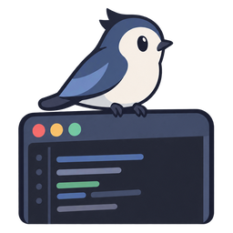

<p align="center">
  
</p>

<h1 align="center">Perch · 栖栖</h1>

<p align="center">一只住在 Windows 桌面上的小桌宠：会聊天、能读写文件，还会替你盯着 Claude Code / Codex / DeepSeek Harness 干活。</p>

Perch 平时站在任务栏和窗口的顶边上，走来走去、跳上跳下，像停在窗沿的小鸟。点一下她就能聊天；你的编程 agent 在思考、等授权、干完活的时候，她会用动画、身边的小标签和气泡告诉你。

> 目前只支持 Windows 10 / 11（x64）。

## 功能

**桌宠本体**
- 默认形象是内置的蓝白小鸟「栖栖」：在窗沿上蹦跳、扇翅膀飞上飞下，思考时歪头冒问号，等你授权时竖起头冠，工作时啄键盘，睡觉时把头埋起来。
- 也可以换成 Codex 宠物格式的精灵图皮肤（`pet.json` + 图集）。
- 在任务栏上沿走动，会自己跳上、跳下窗口顶边；站着的窗口被挪动会跟着走，被盖住会掉下来。
- 可以拖拽，松手后下落；透明区域鼠标穿透。
- 工作模式（不乱走乱跳）；全屏看视频、玩游戏时自动隐藏。
- 可选开机自启动（默认关闭，在「设置 → 常规」里打开）。

**对话**
- 接 OpenAI 兼容接口（DeepSeek、通义、OpenRouter、SiliconFlow 等），可以配多个服务商，按用途分配模型。
- 人格（参考 AstrBot）：名字、系统提示词、预设对话、各自的皮肤。
- 点桌宠弹出输入气泡，一键展开成聊天窗口；流式回复。
- 每个人格一条连续对话，自动滚动总结；长期记忆在人格之间共享，可在设置里查看和修改。
- 语音输出（可选，默认不读）：在「设置 → 语音」里选朗读引擎——云端（OpenAI 兼容的 `/audio/speech`，比如硅基流动 CosyVoice2、OpenAI）或本地服务（GPT-SoVITS 风格的接口，用你自己的参考音频或服务里的角色声音）。可以选朗读语言，比如显示中文、读日语。本地服务可以设成随 Perch 启动和退出。读桌宠主动说的话和对话回复的开头；全屏、开会、直播时不出声，工作模式和免打扰时段默认也不出声。
- 关系数值：和每个人格各有好感度、信任度、熟悉度、心情，影响回复的语气。熟悉度随聊天增长，其余由辅助模型每隔几轮按对话调整，心情过几个小时会回到平常。聊天里输入 `@状态` 查看，`@好感度 80` 等直接调整，`@记住`、`@忘记` 管理记忆，`@帮助` 看全部命令；命令不会发给模型。可在「设置 → 对话参数」里关闭。
- 记忆检索（可选）：在「设置 → 模型」里配一个向量模型（OpenAI 兼容的 `/embeddings`，比如硅基流动的 `BAAI/bge-m3`），事件记忆就只挑和当前话题相关的几条放进提示词，能记得更多；不配就全部放进去。向量服务出错时自动退回全部放入。
- 可以发图片（主模型看不了图时由视觉模型转述）和文件（文本、PDF、docx）。
- 支持推理强度设置，不支持的模型自动忽略。
- **主动聊天和提醒**（可选，默认关闭，在「设置 → 陪伴」里打开）：很久没聊天时找你说两句，离开后回来打招呼、早上问早安，写代码久了鼓励一句；节日（含农历节日）、生日、纪念日问候；久坐、就寝、每日定时提醒，agent 一直等你授权时再提一次。话由模型按人格口吻写，也可以只用固定话术。看前台程序判断你在干什么：全屏、开会、直播时一句不说，写代码时不闲聊；对话中、录音时不打扰；工作模式和免打扰时段只说重要的提醒。
- **时区**：默认跟随系统，也可以在「设置 → 常规」里选一个时区，提醒、节日和告诉模型的时间都按它算。
- **桌面感知**（可选，默认关闭，在「设置 → 桌面感知」里打开）：授权后可在对话里按需看屏（`see_screen`）；也可让主动聊天在冷却与门禁允许时偶尔看一眼屏幕当闲聊素材。支付/银行/密码管理器等锁死不可截；聊天记录只留缩略图，原图不落盘；窗口标题默认不上传。详见 [第三方声明](THIRD_PARTY_NOTICES.md) 与 [手动测试矩阵](docs/desktop-awareness-manual-tests.md)。

**工具与生图**
- 内置读、写、编辑文件三个工具，只能访问白名单目录；读文件不打扰，写入和编辑会在气泡里显示 diff 等你确认。没有 shell。
- 云端生图（OpenAI 兼容的 `/images/generations`）：`/draw 描述`，或者明确让她画；有每日上限。

**语音输入（可选，默认关闭）**
- 本地识别：SenseVoice + Silero VAD（sherpa-onnx），不上传录音。
- 在「设置 → 语音」里开启，一键下载语音组件：运行库约 8MB（sherpa-onnx v2.0.0，优先走 npmmirror 国内镜像，其次 GitHub 官方发布和 NuGet，解压时校验 SHA256），模型约 240MB（优先走 hf-mirror 镜像）；也可以指定已有的运行库和模型文件夹。
- 按住快捷键（默认 `Ctrl+Shift+Space`）或 🎤 说话，边说边在输入框里预览，松开即识别并发送。
- 不开启时不加载任何语音组件，程序本身不依赖它们。

**Agent 状态汇报**
- **Claude Code**：在 `~/.claude/settings.json` 写入 http 类型 hooks。
- **Codex**：在 `~/.codex/hooks.json` 写入命令型 hooks（一行 PowerShell，把事件转发给桌宠）。
- **DeepSeek Harness**：安装一个 DSH 组合包插件。
- 桌宠动画随状态变化，身边显示「Claude Code · 思考中」「等待授权」这样的小标签；完成、等授权、出错时弹气泡和系统通知，完成时可以用当前人格的口吻总结一两句。
- 第一次启动时检测本机装了哪些 agent，问你要不要接入；也可以随时在设置里开关。

## 从源码运行

需要：

- [Rust](https://rustup.rs/)（stable，MSVC 工具链）和 Visual Studio 的「使用 C++ 的桌面开发」组件
- [Node.js](https://nodejs.org/) 20+ 和 [pnpm](https://pnpm.io/)
- WebView2（Windows 11 自带）

```sh
pnpm install
pnpm tauri dev
```

第一次构建时，`sherpa-onnx` 会从 GitHub 下载预编译库，构建脚本会把 `sherpa-onnx-c-api.dll`、`onnxruntime.dll` 等复制到程序旁边，所以从源码运行时不用再下载语音运行库。程序对这些 DLL 是延迟加载的：只有开启语音输入后才会加载。

运行测试：

```sh
cd src-tauri
cargo test --lib
```

## 使用

1. 第一次启动时，桌宠会在气泡里请你选一家服务商（DeepSeek、通义、硅基流动等）并粘贴 API Key，测试通过就能聊天；也可以右键托盘图标 →「设置」，在「模型」里添加服务商（地址、模型名、API Key），在「人格」里写好她的性格。
2. 单击桌宠开始聊天。想用语音输入，到「语音」里开启并下载语音组件，之后按住 `Ctrl+Shift+Space` 说话。
3. 想让她读写文件，先在「工具与生图」里加白名单目录；生图服务也在这里配置。
4. 在「Agent 接入」里打开需要的接入：
   - Codex：开启或修复后，要在 Codex 里输入 `/hooks` 信任桌宠的 hooks。
   - DeepSeek Harness：需要先在 DSH 菜单「管理 dsh 命令…」里安装命令行；装好插件后重启 DSH。
5. 想让她把话读出来，看下面的[语音朗读使用指南](#语音朗读使用指南)。

**皮肤**：默认是内置的栖栖。想换别的，在托盘「皮肤」→「导入皮肤（zip）…」里选一个皮肤压缩包，导入后直接换上；也可以把 Codex 宠物文件夹放进 `%USERPROFILE%\.codex\pets\` 或 `%APPDATA%\Perch\skins\`，在托盘「皮肤」菜单里选择。自己做皮肤的格式见 [docs/skin-format.md](docs/skin-format.md)。

**渲染器插件**：精灵图集以外的形象（比如骨骼动画）由插件负责画，插件放在 `%APPDATA%\Perch\plugins\` 下，皮肤在 `skin.json` 里写明要用哪个渲染器，用到时才加载。插件格式见 [docs/renderer-plugin.md](docs/renderer-plugin.md)，[examples/renderer-plugin](examples/renderer-plugin) 里有一个可以直接用的示例。插件代码在桌宠窗口里运行，只安装你信任的插件。

**更新**：在「设置 → 常规」里点「检查更新」，有新版本时点「下载并安装」。下载后会校验 SHA256，安装时 Perch 会退出，装完自动打开，设置和数据都不变。

## 语音朗读使用指南

Perch 不自带语音模型，默认也不朗读。在「设置 → 语音 → 语音输出（朗读）」里选一个朗读引擎才会读。

| 方式 | 需要什么 | 适合 |
|---|---|---|
| 云端服务 | 一个 API Key，不需要显卡 | 想最快用上 |
| 本地服务 + 参考音频 | 自己部署 GPT-SoVITS 这类服务，最好有显卡 | 想模仿某个声音 |
| 本地服务 + 角色声音 | 自己部署带角色声音的服务（比如带 LoRA 的 Qwen3TTS），需要显卡 | 已经有训练好的声音 |

### 云端服务

要读的文字会发给你选的服务商。

1. 在「设置 → 模型」里添加服务商，填 API Key。预设里有「语音合成：硅基流动 CosyVoice2」和「语音合成：OpenAI gpt-4o-mini-tts」，其他 OpenAI 兼容的 `/audio/speech` 服务用「自定义」。
2. 把这个模型选为「语音合成」用途。
3. 在「设置 → 语音」里把朗读引擎选成云端，选或填一个音色。音色名以服务商的文档为准。
4. 点「试听」。出错时会显示服务返回的原因。服务要能返回 wav 格式。

### 本地服务

1. 先启动你的服务，默认地址是 `http://127.0.0.1:9880/`。
2. 在「设置 → 语音」里把朗读引擎选成本地服务，填服务地址。
3. 选声音，二选一：
   - **角色声音**：点「读取列表」，从服务提供的声音里选一个。
   - **参考音频**：选一段 3～10 秒的干净人声，再填上音频里说的话，这样更像。路径要是服务那台机器能读到的。
4. 按服务的要求填语言代码，比如 `zh`、`ja`、`en`。
5. 点「试听」。

服务要提供 GPT-SoVITS 风格的接口，并返回 wav。角色声音还要求服务有 `GET /lora/list` 接口，请求时用 `lora_id` 和 `speaker` 选声音。语速要服务支持才有效。

**随 Perch 启动**：勾选「随 Perch 启动」并选好启动脚本（`.bat`、`.cmd` 或 `.exe`），下次打开 Perch 时会在后台运行它，退出时关掉。

- 服务已经在运行时不会重复启动，也不会被关掉。
- 批处理脚本要用 CRLF 换行，否则可能启动失败。
- 启动失败的原因写在数据目录（`%APPDATA%\Perch`）的 `tts-service.log` 里。
- 只选你信任的脚本。

### 用其他语言说

可以让桌宠显示一种语言、读另一种语言。比如声音模型是用日语训练的，日语往往比中文更像本人，这时可以显示中文、读日语。

在「朗读语言」里选一种语言，朗读前会用辅助模型翻译成它，气泡和聊天记录里的文字不变。可选中文、日语、英语、韩语、法语、德语、西班牙语、意大利语、葡萄牙语、俄语。

- 声音模型要支持这种语言，否则读出来会不自然。
- 需要配好对话模型或辅助模型。每句会多一次模型请求，要多等一两秒。
- 翻译失败时读原文。

### 读什么、什么时候不读

- 桌宠主动说的话（agent 汇报、提醒、闲聊）读整句，对话回复只读开头，默认最多 60 字，可以调。
- 全屏、开会、通话、看视频时不出声，工作模式和免打扰时段默认也不出声。
- 开始录音或发新消息时，正在读的内容会被打断。

### 声音的版权

模仿真人的声音、使用游戏或动画角色的声音时，请确认你有权这样做。Perch 不提供任何声音模型或下载链接。

## 数据与隐私

- 设置、聊天记录、记忆、语音模型和运行库都在 `%APPDATA%\Perch`；API Key 存在 Windows 凭据管理器，不写进配置文件。
- 聊天内容会发给你配置的模型服务商。开启「完成时用人格口吻总结」后，agent 的最后一条回复也会发给辅助模型；关掉则不转发任何内容。
- 语音识别完全在本地进行。
- Agent 接入会修改对应工具的配置文件：第一次改动前自动备份，只增删桌宠自己的条目，关闭接入即可移除。
- 接收 agent 事件的服务只监听 `127.0.0.1`，并校验随机令牌。
- 只有在「设置 → 常规」里点「检查更新」时才会访问 GitHub，不在后台检查。

## 已知限制

- 安装包不附带语音运行库，开启语音输入时在设置里下载。自动下载都失败时，「设置 → 语音」里有手动下载的链接（[npmmirror](https://registry.npmmirror.com/sherpa-onnx-win-x64/-/sherpa-onnx-win-x64-2.0.0.tgz)、[GitHub](https://github.com/k2-fsa/sherpa-onnx/releases/download/v2.0.0/sherpa-onnx-v2.0.0-win-x64-shared-MT-Release-lib.tar.bz2)），解压后把 `onnxruntime.dll` 和 `sherpa-onnx-c-api.dll` 放进同一个文件夹，在设置里指定它。
- 换了运行库文件夹要重启程序才生效。
- 只支持 Windows。
- 预留了接口、尚未实现：在桌宠里审批 agent 授权、本地生图。
- 桌面感知：窗口捕获（WGC）不含独立弹出的右键菜单/部分对话框，问这些内容时请用整屏（`scope: "screen"`）；全屏时的系统通知可能被 Windows 勿扰静默进通知中心——需要气泡提醒时可在托盘关掉「全屏时自动隐藏」。

## 致谢

- [Tauri](https://tauri.app/)
- [sherpa-onnx](https://github.com/k2-fsa/sherpa-onnx)（Apache-2.0）
- 语音模型 [SenseVoice](https://github.com/FunAudioLLM/SenseVoice) 和 [Silero VAD](https://github.com/snakers4/silero-vad) 在运行时下载，不随本仓库分发，使用时请遵守各自的许可证。
- 桌面感知画面变化打分移植自 [dsh-see-now](https://github.com/SAOS-3624/dsh-see-now)（Apache-2.0，`cuts.js` 的 `gridRgb` / `rgbToHsv` / `scorePair`；提交见 `THIRD_PARTY_NOTICES.md`）；算法原始出处亦见同作者 [dsh-video-storyboard](https://github.com/SAOS-3624/dsh-video-storyboard)。Windows 截屏使用 [windows-capture](https://crates.io/crates/windows-capture)（MIT）。
- **本仓库当前版本的桌面感知实现不含任何 GPL 代码**（含 bandori-pet-rev 等仅作思路参考，干净室自写）。完整第三方义务见 [THIRD_PARTY_NOTICES.md](THIRD_PARTY_NOTICES.md)。
- 设计上参考了 BongoCat、clawd-on-desk、VPet、DyberPet 等桌宠项目（只参考设计，没有使用它们的代码）。

## 许可证

[PolyForm Noncommercial License 1.0.0](LICENSE)（SPDX：`PolyForm-Noncommercial-1.0.0`）。

- 允许非商业用途的使用和修改：个人学习、研究、娱乐和爱好项目，以及慈善机构、教育机构、公共研究机构、公共安全或卫生组织、环保组织、政府机构使用。**禁止商业用途**，需要商用授权请通过 [GitHub Issues](https://github.com/mtdxmtdx/Perch/issues) 联系作者。
- 再分发时要附上许可证全文（或链接）和 `LICENSE` 开头的 `Required Notice` 版权声明。
- 这是"源码公开、禁止商用"的许可证，不属于 OSI 定义的开源许可证。
- **v0.1.0 及之前的版本以 [GPL-3.0-only](https://www.gnu.org/licenses/gpl-3.0.html) 发布**，那些版本仍按 GPL 授权；之后的版本使用本许可证。
